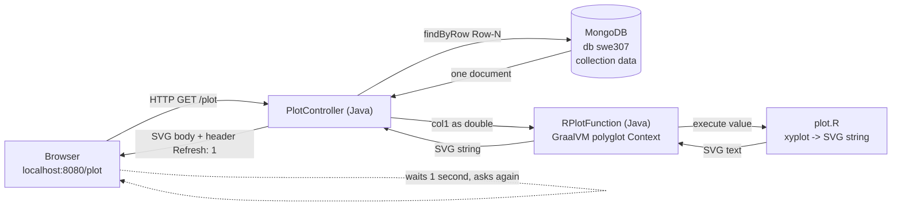

# SWE 307 – Big Data Project 1 — Study Guide

A complete explanation of this project for the whole group. Read this top to
bottom and you will be able to explain every file and every design choice in
class. Nothing here changes the code; it only describes the code that is
already in the repository.

---

## 1. PROJECT SUMMARY

### What the assignment asks

Build a **Java Spring Boot** web application that:

- reads **one value per second** from **MongoDB** — and the reading is done in
  **Java**, not in R;
- passes that single number (a `double`) to an **R plotting function** that runs
  on **GraalVM** (so Java and R run together in one program);
- uses only **one column** of the data — our group's column is **`Col-1`** — and
  it must be easy to switch to another column;
- draws the chart with R's **`xyplot()`** from the **lattice** package, with the
  **x-axis from 0 to 99**, the **y-axis = the values**, a **line**, a **dark
  brown** colour, and a **grid**;
- sends R's picture (an **SVG** image) to the **browser**, and the page
  **refreshes every second** so the chart keeps updating.

### Requirement → where the code meets it

| Requirement | Where it is done | Key line(s) |
|---|---|---|
| Spring Boot web app | `Pro1Application.java`, `pom.xml` (webmvc starter) | `@SpringBootApplication` |
| Connect to MongoDB | `application.properties` | `spring.mongodb.uri=mongodb://localhost:27017/swe307` |
| Read **one value per second**, in **Java** | `PlotController.java` (driven by the 1-second page refresh) | `findByRow(...)`, `getCol1()`, `header("Refresh","1")` |
| Use only **Col-1**, easy to change | `DataRow.java` | `@Field("Col-1") private double col1;` |
| Call **R** from Java over **GraalVM** | `RPlotFunction.java` | `Context.newBuilder("R")`, `plotFunction.execute(value)` |
| **xyplot**, x 0–99, y = values, line, dark brown, grid | `plot.R` | `xyplot(values ~ 0:99, type = c("g","l"), col = "#654321", ...)` |
| Send **SVG** to browser | `RPlotFunction.java` + `PlotController.java` | `svg.off()` returns SVG; controller returns it with type `image/svg+xml` |
| **Auto-refresh every second** | `PlotController.java` | `.header("Refresh", "1")` |

---

## 2. ARCHITECTURE

### The picture



### One full request, step by step

1. The browser asks for `GET http://localhost:8080/plot`.
2. Spring routes that request to the `plot()` method in **`PlotController`**.
3. The controller moves its counter to the next row: `index = index % 100 + 1`,
   giving `1, 2, 3, … 100, 1, 2, …`.
4. It builds the label `"Row-" + index` (for example `"Row-7"`) and calls
   `repository.findByRow("Row-7")`. **Spring Data MongoDB** runs the query and
   returns one `DataRow` object.
5. The controller reads the single value it needs: `document.getCol1()` — this is
   the **one value per second**, read **in Java**.
6. It calls `plotFunction.apply(value)`. That is the **`RPlotFunction`** bean,
   which forwards the number into R by calling the R function
   (`plotFunction.execute(value)`).
7. Inside **`plot.R`**, R shifts the number into its 100-element `values` vector
   (drops the oldest, adds the newest at the end), draws the chart with
   `xyplot()` onto an in-memory SVG device, and `svg.off()` returns the finished
   picture as one big **SVG string**.
8. That SVG string travels back: R → `RPlotFunction` (as a `String`) →
   `PlotController`.
9. The controller returns the SVG as the HTTP response body with
   `Content-Type: image/svg+xml` and the extra header `Refresh: 1`.
10. The browser draws the SVG, then — because of `Refresh: 1` — **waits one
    second and requests `/plot` again**, which starts the whole loop over at
    step 1 with the next row. This is what makes the chart update once per second.

---

## 3. ENVIRONMENT SETUP (what we did and why)

Each step has a reason, because the instructor may ask "why".

1. **Windows + WSL2 Ubuntu.**
   *Why:* GraalVM's R engine (**FastR**) has **no Windows build**, and its last
   release line is **22.3**. So we run everything inside a real Linux
   (Ubuntu) using WSL2 on the Windows laptop.

2. **System build tools:**
   ```bash
   sudo apt install build-essential gfortran libgomp1 zlib1g-dev
   ```
   *Why:* FastR and some R packages compile and run native (C/Fortran) code.
   `build-essential` gives a C/C++ compiler and `make`; `gfortran` is the Fortran
   compiler many numeric R packages need; `libgomp1` is the OpenMP runtime for
   parallel native code; `zlib1g-dev` is a compression library R links against.
   Without these, FastR or lattice can fail to start.

3. **GraalVM CE 22.3.0 (Java 17)** unpacked in the home folder, with
   `JAVA_HOME` and `PATH` set in `~/.bashrc`:
   ```bash
   export JAVA_HOME=/root/graalvm-ce-java17-22.3.0
   export PATH=$JAVA_HOME/bin:$PATH
   ```
   *Why:* GraalVM **is** our Java 17 JDK, and it is also the engine that can run
   R in the same process (the "polyglot" feature). Putting it on `PATH` means
   `java` and `./mvnw` use GraalVM. Setting this in `~/.bashrc` makes it apply to
   every new terminal.

4. **Add the R language to GraalVM:**
   ```bash
   gu install R
   ```
   *Why:* `gu` is GraalVM's component installer. This adds **FastR** (GraalVM's R
   implementation). The **lattice** package (which has `xyplot`) ships with it,
   so we did not have to install lattice separately.

5. **MongoDB in Docker:**
   ```bash
   docker run -d --name mongo -p 27017:27017 mongo:7
   ```
   *Why:* Docker gives us a ready MongoDB server without installing it on the OS.
   `-d` runs it in the background, `--name mongo` names the container, and
   `-p 27017:27017` publishes MongoDB's default port so our Java app can reach it
   at `localhost:27017`.

6. **Load the data.** We downloaded `swe307_pro1.csv` from the instructor's
   GitHub. The first header cell was empty, so we named it `Row`:
   ```bash
   sed -i '1s/^,/Row,/' swe307_pro1.csv
   ```
   (`1s/^,/Row,/` = on line 1 only, replace a leading comma with `Row,`.) Then we
   copied the file into the container and imported it:
   ```bash
   docker cp swe307_pro1.csv mongo:/tmp/
   docker exec mongo mongoimport --db swe307 --collection data --type csv \
     --headerline --maintainInsertionOrder --file /tmp/swe307_pro1.csv
   ```
   *Why each flag:* `--db swe307` and `--collection data` choose where the data
   lands; `--type csv` says the file is CSV; `--headerline` uses the first row as
   the field names (`Row`, `Col-1` … `Col-21`); `--maintainInsertionOrder` keeps
   the rows in file order.
   **Result:** database **`swe307`**, collection **`data`**, **100 documents**,
   each with fields `Row` (`"Row-1"`…`"Row-100"`) and `Col-1`…`Col-21`.

7. **Project generated with Spring Initializr** (Maven, Java 17, dependencies
   *Web* + *Data MongoDB*), **Spring Boot 4.1.1**.
   *Why:* Initializr creates a correct Maven project with the right starter
   dependencies and the `mvnw` wrapper, so we did not configure Maven by hand.

---

## 4. FILE-BY-FILE EXPLANATION

### 4.1 `src/main/resources/application.properties`

```properties
spring.application.name=pro1
spring.mongodb.uri=mongodb://localhost:27017/swe307
```

- `spring.application.name=pro1` — just a name for the app; it appears in log
  output. Harmless.
- `spring.mongodb.uri=mongodb://localhost:27017/swe307` — tells Spring Boot where
  MongoDB is.
  - `mongodb://` — the MongoDB connection-string format.
  - `localhost:27017` — the Docker MongoDB, reachable on the published port.
  - `/swe307` — the **default database** the app uses. Because the database name
    is in the URI, Spring uses `swe307` automatically.
  - **Important Spring Boot 4 detail:** the property is **`spring.mongodb.uri`**.
    In older Spring Boot (3.x) it was `spring.data.mongodb.uri`. If we used the
    old name here, Boot 4 would ignore it and quietly connect to a default
    `test` database — and our 100 documents would not be found.

### 4.2 `pom.xml` (only the parts that matter)

```xml
<parent>
    <groupId>org.springframework.boot</groupId>
    <artifactId>spring-boot-starter-parent</artifactId>
    <version>4.1.1</version>
</parent>
<properties>
    <java.version>17</java.version>
</properties>
```
- The **parent** is Spring Boot 4.1.1; it manages versions of all Spring
  dependencies so we do not pick them by hand.
- `java.version = 17` — compile for Java 17 (GraalVM 22.3 is a Java 17 JDK).

```xml
<dependency>
    <groupId>org.springframework.boot</groupId>
    <artifactId>spring-boot-starter-data-mongodb</artifactId>
</dependency>
<dependency>
    <groupId>org.springframework.boot</groupId>
    <artifactId>spring-boot-starter-webmvc</artifactId>
</dependency>
```
- `spring-boot-starter-data-mongodb` — brings in Spring Data MongoDB: the
  `@Document` mapping, `MongoRepository`, and auto-configuration of the database
  connection.
- `spring-boot-starter-webmvc` — brings in the web server (embedded Tomcat) and
  Spring MVC, so we can have a `/plot` web endpoint.

```xml
<dependency>
    <groupId>org.graalvm.sdk</groupId>
    <artifactId>graal-sdk</artifactId>
    <version>22.3.0</version>
    <scope>provided</scope>
</dependency>
```
- `graal-sdk` **22.3.0** — contains the **polyglot API** (`Context`, `Value`)
  that lets Java call R. Version 22.3.0 matches our installed GraalVM exactly.
- `<scope>provided</scope>` — "available to compile against, but **the runtime
  already provides it**." Our GraalVM JDK already has these classes, so we must
  not bundle a second copy. `provided` lets the code compile without shipping a
  conflicting duplicate. (This is also why we do **not** use the newer
  `org.graalvm.polyglot` artifacts — they are for newer GraalVM versions.)

The two `*-test` dependencies are only used when running tests and do not affect
the running app.

### 4.3 `src/main/java/com/swe307/pro1/DataRow.java`

```java
package com.swe307.pro1;

import org.springframework.data.annotation.Id;
import org.springframework.data.mongodb.core.mapping.Document;
import org.springframework.data.mongodb.core.mapping.Field;

@Document(collection = "data")
public class DataRow {

    @Id
    private String id;

    @Field("Row")
    private String row;

    @Field("Col-1")
    private double col1;

    public String getId() { return id; }
    public String getRow() { return row; }
    public double getCol1() { return col1; }
}
```

- `package com.swe307.pro1;` — same package as the app, so Spring finds this
  class automatically.
- `@Document(collection = "data")` — this Java class represents one document in
  the MongoDB **`data`** collection.
- `@Id private String id;` — maps MongoDB's automatic `_id`. We do not use it,
  but mapping it is standard.
- `@Field("Row") private String row;` — maps the document field named `Row`
  (values `"Row-1"`…`"Row-100"`) to this Java field.
- `@Field("Col-1") private double col1;` — **the key line.** The real field name
  in MongoDB is `Col-1`, which is **not a legal Java name** (the hyphen), so the
  Java field is called `col1` and `@Field("Col-1")` connects them. The type is
  `double`. Some values are stored as integers and some as decimals; Spring's
  converter turns either into a `double`.
  **To use another group's column, change only this one string** (for example
  `@Field("Col-5")`).
- The three getters let other classes read the values. MongoDB fills the private
  fields by reflection, so we do not need setters for reading.

### 4.4 `src/main/java/com/swe307/pro1/DataRowRepository.java`

```java
package com.swe307.pro1;

import org.springframework.data.mongodb.repository.MongoRepository;

public interface DataRowRepository extends MongoRepository<DataRow, String> {

    DataRow findByRow(String row);
}
```

- `interface ... extends MongoRepository<DataRow, String>` — we only declare the
  interface; **Spring writes the implementation for us** at startup. The generics
  mean: this repository stores `DataRow` objects whose id type is `String`. From
  `MongoRepository` we also inherit ready-made methods like `findAll()`,
  `count()`, `save()`.
- `DataRow findByRow(String row);` — a **derived query method**. Spring reads the
  method name `findByRow`, matches `Row` to the document field, and generates the
  query "find the document where `Row` equals the argument." So
  `findByRow("Row-7")` returns that one document. We write no query code.

### 4.5 `src/main/resources/plot.R`

```r
library(lattice)

values <- rep(0, 100)

function(value) {
  values[1:99] <<- values[2:100]
  values[100] <<- value

  svg(width = 10, height = 6)
  print(xyplot(values ~ 0:99,
               type = c("g", "l"),
               col = "#654321",
               lwd = 2.5,
               main = "SWE 307 - Col-1 Live Data",
               xlab = "Sample (0-99)",
               ylab = "Value",
               ylim = c(-1.2, 1.2),
               scales = list(x = list(at = seq(0, 99, by = 11)), tck = c(1, 0))))
  svg.off()
}
```

- `library(lattice)` — load the lattice package so `xyplot()` works. Runs once
  when the script is first evaluated.
- `values <- rep(0, 100)` — create the **persistent 100-value vector**, filled
  with 100 zeros. It is created once and remembered between calls.
- `function(value) { ... }` — the **last expression in the file is this
  function**, so evaluating `plot.R` **returns the function**. Java keeps this
  function and calls it every second with one number.
- `values[1:99] <<- values[2:100]` — shift the window left: positions 1–99 take
  what was in positions 2–100 (the oldest value is dropped). `<<-` writes to the
  outer `values` (the one created above), **not** a local copy — this is what
  makes the data persist between calls.
- `values[100] <<- value` — put the new value at the end. Together these two
  lines make a **scrolling window** of the last 100 values.
- `svg(width = 10, height = 6)` — open an **in-memory SVG graphics device** sized
  10×6 inches (wide, landscape). FastR captures the drawing as SVG text.
- `print(xyplot(...))` — draw the plot onto that device. Inside a function,
  lattice charts do not display unless you `print()` them, so `print()` is
  required.
  - `values ~ 0:99` — plot `values` (y) against `0,1,…,99` (x): **x-axis 0–99,
    y = the values.**
  - `type = c("g", "l")` — `"g"` draws the **grid**, `"l"` draws the **line**.
  - `col = "#654321"` — the **dark brown** line colour (a hex code; see below).
  - `lwd = 2.5` — line width 2.5× default, so the line is easy to see.
  - `main = "SWE 307 - Col-1 Live Data"` — the chart title.
  - `xlab` / `ylab` — axis labels ("Sample (0-99)" and "Value").
  - `ylim = c(-1.2, 1.2)` — **fix** the y-axis from −1.2 to 1.2 so it does not
    rescale every second; the motion then reads as real data change. (Values
    outside this range would be clipped.)
  - `scales = list(x = list(at = seq(0, 99, by = 11)), tck = c(1, 0))` — custom
    axes: x-axis ticks at `0, 11, 22, …, 99`; `tck = c(1, 0)` shows normal ticks
    on the bottom/left axes and none on the top/right.
- `svg.off()` — FastR's partner to `svg()`: it closes the device and **returns
  the finished SVG as a string**. It is the last line, so that SVG string is the
  function's return value — which Java sends to the browser.

### 4.6 `src/main/java/com/swe307/pro1/RPlotFunction.java`

```java
package com.swe307.pro1;

import jakarta.annotation.PostConstruct;
import jakarta.annotation.PreDestroy;
import org.graalvm.polyglot.Context;
import org.graalvm.polyglot.Value;
import org.springframework.core.io.ClassPathResource;
import org.springframework.stereotype.Component;

import java.io.IOException;
import java.io.InputStream;
import java.nio.charset.StandardCharsets;
import java.util.function.Function;

@Component
public class RPlotFunction implements Function<Double, String> {

    private Context context;
    private Value plotFunction;

    @PostConstruct
    public void init() throws IOException {
        context = Context.newBuilder("R").allowAllAccess(true).build();

        String rCode;
        try (InputStream in = new ClassPathResource("plot.R").getInputStream()) {
            rCode = new String(in.readAllBytes(), StandardCharsets.UTF_8);
        }

        plotFunction = context.eval("R", rCode);
    }

    @Override
    public synchronized String apply(Double value) {
        Value result = plotFunction.execute(value);
        return result.asString();
    }

    @PreDestroy
    public void close() {
        if (context != null) {
            context.close();
        }
    }
}
```

- `@Component` — makes this a Spring **bean**, created at startup and injectable
  into the controller.
- `implements Function<Double, String>` — to the rest of the app it is simply "a
  function: give a `Double`, get back a `String` (the SVG)." All the R machinery
  hides inside.
- `private Context context;` — the **one** long-lived R engine for the whole app.
  Keeping a single one is what lets the R-side `values` vector persist and the
  chart scroll.
- `private Value plotFunction;` — a handle to the R function returned by
  `plot.R`.
- `@PostConstruct public void init()` — runs **once, right after the bean is
  built**:
  - `Context.newBuilder("R").allowAllAccess(true).build()` — build the R engine.
    `"R"` selects FastR. `allowAllAccess(true)` lets R use host resources it needs
    for graphics; without it FastR is sandboxed and the plot fails.
  - the `try (InputStream ...)` block — read the whole `plot.R` file from the
    classpath into the string `rCode` (as UTF-8). Try-with-resources closes the
    stream automatically.
  - `plotFunction = context.eval("R", rCode)` — **run `plot.R` inside R.** Because
    the last expression in the script is the function, evaluating the script
    returns that function, and we keep the handle in `plotFunction`.
- `@Override public synchronized String apply(Double value)` — called once per
  request:
  - `synchronized` — the **single-thread guard**. A polyglot `Context` may be
    used by only one thread at a time. `synchronized` forces overlapping requests
    to take turns, so only one thread is ever inside R.
  - `plotFunction.execute(value)` — call the R function with the number; the
    `Double` becomes an R numeric. Returns a `Value` wrapping R's result.
  - `result.asString()` — turn R's returned SVG into a Java `String`.
- `@PreDestroy public void close()` — on shutdown, close the R `Context` to free
  resources.

### 4.7 `src/main/java/com/swe307/pro1/PlotController.java`

```java
package com.swe307.pro1;

import org.springframework.http.ResponseEntity;
import org.springframework.web.bind.annotation.GetMapping;
import org.springframework.web.bind.annotation.RestController;

@RestController
public class PlotController {

    private final DataRowRepository repository;
    private final RPlotFunction plotFunction;

    private int index = 0;

    public PlotController(DataRowRepository repository, RPlotFunction plotFunction) {
        this.repository = repository;
        this.plotFunction = plotFunction;
    }

    @GetMapping(value = "/plot", produces = "image/svg+xml")
    public ResponseEntity<String> plot() {
        index = index % 100 + 1;

        DataRow document = repository.findByRow("Row-" + index);
        double value = document.getCol1();

        String svg = plotFunction.apply(value);

        return ResponseEntity.ok()
                .header("Refresh", "1")
                .body(svg);
    }
}
```

- `@RestController` — a web controller whose return value is sent **straight back
  as the HTTP response body** (no HTML template).
- `private final DataRowRepository repository;` and
  `private final RPlotFunction plotFunction;` — the two beans this controller
  needs.
- `private int index = 0;` — remembers which row we are on. The controller is a
  single shared object, so this value survives between requests. Starting at 0
  means the first request lands on row 1.
- the constructor — **constructor injection**: Spring sees the controller needs a
  `DataRowRepository` and an `RPlotFunction`, finds those beans, and passes them
  in. `final` means they are set once.
- `@GetMapping(value = "/plot", produces = "image/svg+xml")` — maps
  `GET /plot` to this method and sets the response `Content-Type` to
  `image/svg+xml` so the browser renders the body as an image.
- `index = index % 100 + 1;` — step to the next row and **wrap**: `1, 2, …, 100,
  1, 2, …`. **To start on a different row or change the range, edit only this
  line.**
- `repository.findByRow("Row-" + index);` — fetch that one document from MongoDB.
- `double value = document.getCol1();` — read the single `Col-1` value: the **one
  value per second**, read in Java.
- `plotFunction.apply(value);` — hand the value to R; get back the fresh SVG.
- `return ResponseEntity.ok().header("Refresh", "1").body(svg);` — reply with
  HTTP 200, the SVG as the body, and the header **`Refresh: 1`**, which tells the
  browser to reload `/plot` after **1 second** — that reload drives the next
  value. This is the engine of the "every second" behaviour.

---

## 5. KEY CONCEPTS IN PLAIN WORDS

- **NoSQL / document database (MongoDB).** Instead of tables with fixed columns,
  MongoDB stores **documents** (like JSON objects) inside **collections**. Each
  of our 100 documents has fields `Row`, `Col-1` … `Col-21`.
- **Spring Boot auto-configuration.** Spring Boot looks at the libraries on the
  classpath and the properties file and sets things up for you. Because the
  MongoDB starter is present and a URI is given, it automatically creates the
  database connection — no manual setup code.
- **Dependency injection (DI).** We never write `new PlotController(...)`. Spring
  creates the objects (beans) and passes each one what it needs through its
  constructor. This keeps classes loosely connected and easy to test.
- **Derived query methods.** In a Spring Data repository, the **method name**
  describes the query. `findByRow(String)` automatically becomes "find where the
  `Row` field equals this argument." No query language needed.
- **GraalVM polyglot `Context`.** GraalVM can run several languages in one
  program. A `Context` is one running language engine — here an R engine. Java
  talks to it through this object.
- **`Value`.** A Java handle to something that lives inside the `Context`
  (a function, number, or string). `execute(...)` calls it; `asString()` copies
  the result out into Java.
- **R closures and `<<-`.** A **closure** is a function that remembers the
  variables around it when it was created. Our R function remembers `values`.
  Inside the function, `<-` would make a new local variable, but `<<-` updates
  the **outer** `values`, so the data is kept between calls.
- **lattice `xyplot` arguments.** `y ~ x` says what to plot; `type` chooses line
  (`"l"`) and grid (`"g"`); `col`, `lwd` style the line; `main/xlab/ylab` add
  text; `ylim` fixes the y range; `scales` customises tick marks.
- **SVG (Scalable Vector Graphics).** An image described as text (shapes and
  lines in XML). Browsers draw it directly, and it stays sharp at any size. R
  produces the SVG; we send that text to the browser.
- **HTTP `Refresh` header.** A response header `Refresh: 1` tells the browser to
  reload the page after 1 second. That is how the chart refreshes without any
  JavaScript.
- **Why the R call is `synchronized`.** A GraalVM `Context` allows only one thread
  at a time. The web server can handle requests on several threads, so two could
  reach R at once. `synchronized` makes them queue, keeping the single R engine
  safe.

---

## 6. HOW TO RUN IT

### Cold start (nothing running yet)

1. **Start Docker Desktop** on Windows (so WSL can use Docker).
2. In the **Ubuntu (WSL)** terminal, start the database container (it already
   exists, so just start it):
   ```bash
   docker start mongo
   ```
   (Check it is up with `docker ps` — you should see `mongo`.)
3. From the project folder, run the app with the Maven wrapper:
   ```bash
   ./mvnw spring-boot:run
   ```
   The first run after adding the GraalVM dependency downloads it and takes
   longer; startup also loads R and lattice, so give it a moment.
4. Open the browser at:
   ```
   http://localhost:8080/plot
   ```
   You should see the dark-brown line chart with a grid, refreshing every second
   and filling in from the right as values arrive.
5. To stop: press **Ctrl+C** in the terminal. (Optional: `docker stop mongo`.)

### How to change to another group's column

- Open `src/main/java/com/swe307/pro1/DataRow.java` and change the field name in
  the annotation:
  ```java
  @Field("Col-1")   // change "Col-1" to e.g. "Col-7"
  private double col1;
  ```
  That one string is the only required change. (Optional: also update the chart
  title in `plot.R` so it reads the right column name.) Restart the app.

---

## 7. LIKELY QUESTIONS FROM THE INSTRUCTOR (with model answers)

1. **Why GraalVM?**
   Because it can run **R and Java in the same program**. Normal Java cannot run
   R directly; GraalVM's polyglot feature lets Java call an R function and get the
   result back without a separate R process.

2. **Why not just read the data in R?**
   The assignment requires the reading to be done **in Java**. Java reads one
   value from MongoDB each second and passes only that number to R. R only draws.

3. **What happens after row 100?**
   The counter wraps: `index = index % 100 + 1` goes `…99, 100, 1, 2…`, so it
   starts again at `Row-1`. The chart keeps scrolling forever.

4. **What if two browsers open the page at once?**
   Both work, but they **share** one counter and one R engine. The counter would
   advance faster (two requests per second total), and R calls are `synchronized`
   so they take turns safely. The chart stays correct; it just steps quicker.

5. **Why `provided` scope for `graal-sdk`?**
   Our GraalVM JDK already contains the polyglot classes at runtime. `provided`
   means "compile against it but do not package it," avoiding a duplicate,
   conflicting copy.

6. **Why the hex colour `#654321` instead of `"dark brown"`?**
   R has no colour named `"dark brown"` (and names never contain spaces);
   `"darkbrown"` does not exist either, so R would throw an error. `#654321` is a
   dark-brown hex value that always works.

7. **Why `spring.mongodb.uri` and not `spring.data.mongodb.uri`?**
   In Spring Boot 4 the MongoDB property moved out of the `spring.data` group. The
   old name would be ignored, and the app would connect to the wrong (default)
   database.

8. **How does the page refresh without JavaScript?**
   The response includes the header `Refresh: 1`. The browser understands this
   and reloads the page after one second.

9. **How is "one value per second" actually achieved?**
   The browser reloads every second (because of `Refresh: 1`); each reload is one
   request, and each request reads exactly one value. So one reload = one value =
   one second.

10. **Why is the R call `synchronized`?**
    A GraalVM `Context` is single-threaded. The web server may serve requests on
    several threads, so `synchronized` forces them to use R one at a time.

11. **What does `<<-` do in `plot.R`?**
    It assigns to the variable in the **outer** scope (`values`) instead of making
    a local one, so the 100-value vector is remembered between calls.

12. **Why keep only one R `Context` for the whole app?**
    So the R-side state (the `values` vector) survives between requests and the
    chart can scroll. A new context each time would reset to all zeros.

13. **What is `xyplot` and where does it come from?**
    It is a plotting function from R's **lattice** package. We plot
    `values ~ 0:99` as a line with a grid.

14. **Why SVG and not PNG/JPEG?**
    SVG is text, so it is easy to pass back as a string and the browser renders it
    crisply at any size. FastR produces SVG directly via `svg()` / `svg.off()`.

15. **What does `@Field("Col-1")` do and why is it needed?**
    It maps the MongoDB field `Col-1` to the Java field `col1`. It is needed
    because `Col-1` has a hyphen and cannot be a Java variable name. Changing this
    string switches to a different column.

16. **Where is the loop? I do not see a timer in Java.**
    There is no Java timer. The "loop" is the browser reloading every second
    because of the `Refresh` header; each reload triggers the next value.

17. **Why Spring Boot and Maven?**
    Spring Boot gives us an embedded web server and automatic MongoDB setup with
    very little code; Maven (via `./mvnw`) downloads libraries and builds/runs the
    project.

18. **What if MongoDB is not running?**
    The app fails to connect at startup (or the query fails). Start the container
    first with `docker start mongo`.

19. **Why WSL/Ubuntu instead of Windows?**
    FastR (GraalVM's R) has no Windows version, so we run everything in Linux via
    WSL2.

20. **How do you know the data went into Mongo correctly?**
    After `mongoimport` we have database `swe307`, collection `data`, 100
    documents with fields `Row` and `Col-1…Col-21`. You can verify with
    `docker exec mongo mongosh swe307 --eval "db.data.countDocuments()"`.

---

## 8. GLOSSARY

- **Bean** — an object that Spring creates and manages for you.
- **Classpath** — the set of folders and libraries available to the running Java
  program; `plot.R` lives on it under `resources`.
- **Closure (R)** — a function that remembers the variables around it; ours
  remembers `values`.
- **Collection (MongoDB)** — a group of documents, like a table of rows. Ours is
  `data`.
- **Constructor injection** — Spring passing a class's dependencies through its
  constructor.
- **Container (Docker)** — a lightweight, isolated package that runs software;
  ours runs MongoDB.
- **Context (GraalVM)** — one running language engine inside the program; here, R.
- **Dependency injection (DI)** — Spring supplying the objects a class needs
  instead of the class creating them.
- **Derived query method** — a repository method whose name defines the database
  query (e.g. `findByRow`).
- **Document (MongoDB)** — one record, shaped like a JSON object with fields.
- **Double** — a Java number type for decimals; the value we pass to R.
- **FastR** — GraalVM's implementation of the R language.
- **GraalVM** — a JDK that can also run other languages (like R) in the same
  process.
- **Hex colour** — a colour written as `#RRGGBB`; `#654321` is dark brown.
- **HTTP header** — extra information sent with a web response; `Refresh: 1` asks
  the browser to reload.
- **lattice** — an R package for plotting; it provides `xyplot`.
- **Maven** — the build tool that downloads libraries and builds/runs the project;
  we use the `./mvnw` wrapper.
- **MongoDB** — a NoSQL document database.
- **NoSQL** — a database that does not use SQL tables; stores documents, key-value
  pairs, etc.
- **Polyglot** — "many languages"; GraalVM's ability to mix languages in one
  program.
- **Port** — a numbered channel on a machine; MongoDB uses 27017, the web app uses
  8080.
- **Repository** — a Spring interface that provides database operations without
  our writing the code.
- **SVG** — Scalable Vector Graphics; an image described as text that browsers
  draw directly.
- **Spring Boot** — a framework that makes it fast to build Java web/data apps
  with minimal setup.
- **Spring Data MongoDB** — the Spring library that maps Java classes to MongoDB
  documents and generates queries.
- **starter** — a bundle of related dependencies in Spring Boot (e.g.
  `spring-boot-starter-webmvc`).
- **`synchronized`** — a Java keyword making a method usable by only one thread at
  a time.
- **`Value` (GraalVM)** — a Java handle to something inside a polyglot `Context`.
- **WSL2** — Windows Subsystem for Linux; runs real Ubuntu inside Windows.
- **xyplot** — the lattice function that plots y against x; we use it for the
  chart.
- **`<<-` (R)** — the "super-assignment" operator that writes to a variable in an
  outer scope.
